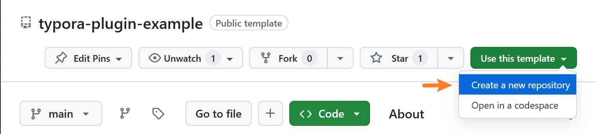

# Quick Start

The following briefly introduces how to compile your first plugin.


## Development Environment Preparation

| Action | Purpose |
| --- | --- |
| Register a [GitHub](https://github.com/) account | To create a plugin project from a template, host code, and publish plugins |
| Install [Git](https://git-scm.com/) | To download and upload plugin project code |
| Install [VSCode](https://code.visualstudio.com/) | To edit plugin code |
| Install [Node.js](https://nodejs.org/) | To compile plugins |
| Install [PNPM](https://pnpm.io/) | To install dependencies (using file links to reduce file redundancy) |
| Install [NRM](https://github.com/Pana/nrm) | (Optional) Switch registry mirrors (e.g. the Taobao mirror for faster access in China) |


## Prerequisite Knowledge

- [TypeScript](https://www.typescriptlang.org/): Used to provide type definitions.


## Build Your First Plugin

### Create a Project

1) Log in to GitHub and use the example plugin project [typora-plugin-example](https://github.com/typora-community-plugin/typora-plugin-example) as a template to create a new plugin project.





2) Clone your plugin project to your local machine with Git:


```sh
git clone https://github.com/{user-name}/{plugin-name}
```

3.1) Open the plugin project folder in VSCode and press <kbd>Ctrl</kbd>+<kbd>`</kbd> to open the integrated terminal.

3.2) Run `pnpm install` in the terminal to install the project dependencies.


### Project Structure

The template project is structured as follows (the template repository is authoritative):

```
plugin-name
├── src
│   ├── main.ts          # Plugin entry, exports a Plugin subclass
│   ├── manifest.json    # Plugin metadata
│   ├── style.scss       # Plugin styles (built into style.css)
│   └── locales          # Locale JSON files (optional)
├── build.js             # Build script
├── pack.js              # Package script
├── package.json
└── dist                 # Build output: main.js, style.css
```

> Plugin metadata lives in `src/manifest.json`. It is copied to the root of the build output when building/packaging, so the file name inside the final zip is `manifest.json`.

Common scripts:

| Command | Purpose |
| --- | --- |
| `pnpm run build:dev` | Compile the plugin in development mode and launch Typora with the development `core` |
| `pnpm run build` | Compile in production mode |
| `pnpm run pack` | Package `dist/` and `manifest.json` into `plugin.zip` |


### Compile the Plugin

Add the Typora installation directory to the `PATH` environment variable.

Run `pnpm run build:dev` in the terminal. This enters the development environment, compiles the plugin, and opens it with Typora.

> Typora now opens automatically, and a dialog box showing `hello, typora` pops up.


### Modify the Plugin

In VSCode, open `src/main.ts` and modify the code:

```diff
  export default class extends Plugin {

    onload() {
-     alert('hello, typora')
+     alert('hello, my first plugin')
    }

    onunload() {
      // dispose resources, like events, processes...
    }
  }
```


### Recompile

Run `pnpm run build:dev` again in the terminal. The plugin is recompiled, Typora is reopened, and the plugin is reloaded.

> Typora now opens automatically, and a dialog box showing the modified message `hello, my first plugin` pops up.


## Lifecycle and Resource Disposal

The plugin class extends `Plugin`, which in turn extends `Component`. The plugin manager instantiates your plugin with `new PluginImplement(app, manifest)` and then calls `load()`:

1. `load()` calls `onload()`;
2. `unload()` calls `onunload()` first, then runs the cleanup functions collected via `this.register()`, and finally unloads child components.

Therefore, prefer handing cleanup logic for events, timers, and DOM listeners to `this.register()` instead of piling everything into `onunload()`:

```ts
export default class extends Plugin {
  onload() {
    const timer = setInterval(() => { /* ... */ }, 1000)
    this.registerInterval(timer)

    this.registerDomEvent(window, 'resize', () => { /* ... */ })
  }
}
```

> `load()` does not wait for asynchronous work started in `onload()` to finish. If you need plugin features only after async initialization completes, track the ready state yourself.


## Next Steps

See [Plugin Basics](./2-plugin.md). After modifying, compiling, and testing a few times, you can [release](./9-releasing.md) your plugin to the plugin marketplace for others to download and use.
