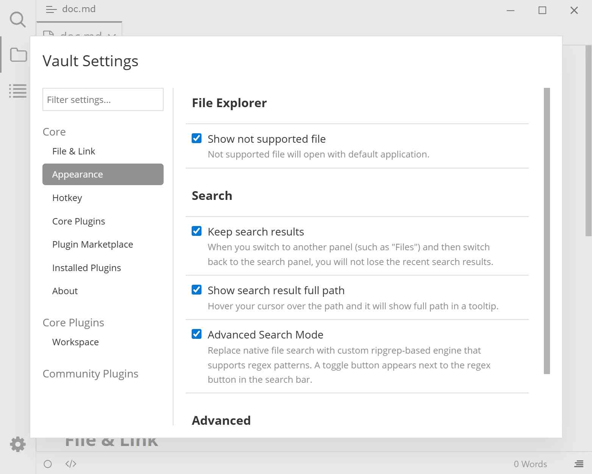

# Appearance

Controls which files the file tree shows, how the search panel behaves, and whether the Ribbon is visible.

## Preview

## Where to find it

Plugin Settings modal (<kbd>Ctrl</kbd>+<kbd>.</kbd>) → Appearance.

## Settings

| Setting | Default | Effect | Notes |
|--------|--------|------|------|
| Show not supported file | Off | Also list images, audio/video, archives, and other non-Markdown files in the file tree; opening them uses the system default application | When off, the file tree only shows supported text files |
| Keep search results | Off | Switching from the search panel to another panel such as "Files" and back does not lose the search results | When off, results are cleared as soon as you switch away |
| Show search result full path | Off | When you hover over a file path in search results, show the full path in a tooltip | Only applies to the search panel |
| Advanced Search Mode | Off | Replace Typora's native search with a custom search engine that supports `tag:`, boolean combinations, and similar syntax | When on, a "Search / Advanced Search" toggle row appears above the search box; see [Advanced search](./4c-advanced-search.md) |
| Show Ribbon | On | Show the [Ribbon](./4b-ribbon.md) on the left and enable custom sidebar panels | When off, the Ribbon disappears entirely; <kbd>F1</kbd> and <kbd>Ctrl</kbd>+<kbd>.</kbd> still work |

## Common usage

**Temporarily turn off the Ribbon**

Plugin Settings modal → Appearance → Advanced → clear "Show Ribbon". Check it again to restore it without restarting.

**Search only Markdown body text, not images and miscellaneous files**

Leave "Show not supported file" off.

## Notes and limitations

- The description of "Advanced Search Mode" says it supports regular expressions, but the actual search engine matches **fixed strings** and does not support regex. See [Advanced search limitations](./4c-advanced-search.md#notes-and-limitations).
- "Show not supported file" makes the file tree longer; keep it off if your vault contains many files.
- "Keep search results" only prevents the panel from clearing results when you switch away; it does not save search content.

## Related pages

- [Advanced search](./4c-advanced-search.md)
- [Ribbon](./4b-ribbon.md)
- [Settings overview](./3-settings.md)
