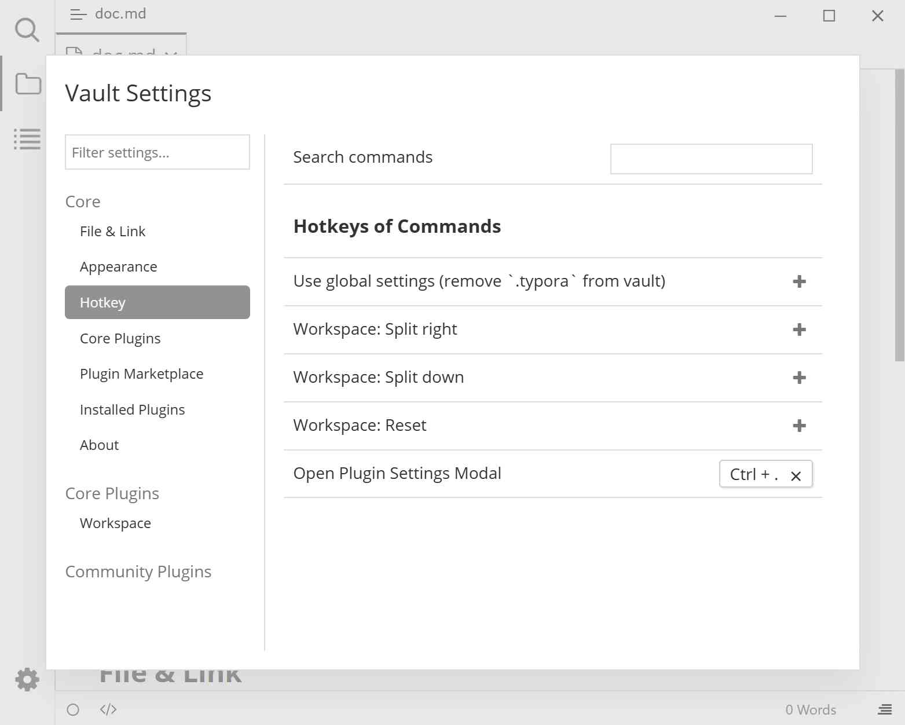

# Hotkey settings

Bind keyboard shortcuts to plugin commands. After a plugin is installed, the commands it registers appear on this page automatically.

## Preview

## Where to find it

Plugin Settings modal (<kbd>Ctrl</kbd>+<kbd>.</kbd>) → Hotkey. You can also press <kbd>F1</kbd> to open the [Command Panel](./6-command-palette.md), run "Open Plugin Settings Modal", and switch to "Hotkey".

## Steps

### Find a command

Enter a command name in the "Search commands" box; the list filters by name (after about 300 milliseconds). Command names include the plugin name as a prefix, e.g. `Tag: Some command`.

### Add a shortcut

1. Find a command that has no shortcut yet and click the  button on its right.
2. The button text changes to "Press hotkey...".
3. Press the key combination you want to bind, e.g. <kbd>Ctrl</kbd>+<kbd>Shift</kbd>+<kbd>K</kbd>.
4. The shortcut takes effect as soon as you release the keys and appears as a removable label.

### Remove a shortcut

Click the <kbd>×</kbd> icon on the right side of the shortcut label. After removal, the command shows the  button again and can be rebound.

## Shortcut format

Shortcuts join modifier keys and the main key with `+`, e.g. `Ctrl+Shift+K`. The system normalizes case and modifier aliases automatically:

| Input | Normalized (Windows / Linux) | Normalized (macOS) |
|------|------------------------------|--------------------|
| `ctrl+k` | `Ctrl+K` | `Ctrl+K` |
| `meta+k`, `command+k`, `cmd+k` | `Win+K` | `Cmd+K` |
| `alt+k`, `option+k` | `Alt+K` | `Opt+K` |
| `ctrl+shift+left` | `Ctrl+Shift+←` | `Ctrl+Shift+←` |

## Notes and limitations

- The list only shows commands that **appear in the Command Panel**; a few internal commands cannot be bound to shortcuts.
- Only one command's binding is changed at a time: while keys are being captured, pressing other keys does not modify other commands.
- Commands have two scopes, defined by the plugin: **global** (works anywhere in Typora) and **editor** (only works when the editor has focus).
- The default shortcuts on macOS are still <kbd>Ctrl</kbd>+<kbd>.</kbd> and <kbd>F1</kbd>; they do not automatically become <kbd>Cmd</kbd>. `Cmd` only appears if you explicitly use `meta`/`cmd` in a custom binding.
- Bindings are saved in the currently active settings (global or vault). You need to rebind them after switching settings mode.

## Appendix: user-visible commands

| Command | Default shortcut | Effect |
|------|------------|------|
| Open Command Panel | <kbd>F1</kbd> | Search and run commands (the command itself does not appear in the Command Panel list) |
| Open Plugin Settings Modal | <kbd>Ctrl</kbd>+<kbd>.</kbd> | Open the modal this page belongs to |
| Use vault settings (add `.typora` to vault) | None | Copy global settings into the vault and switch, only shown when using global settings |
| Use global settings (remove `.typora` from vault) | None | Delete the vault's settings, only shown when using vault settings |
| Workspace: Split right | None | Left/right split view; requires [Workspace](./4a-workspace.md) |
| Workspace: Split down | None | Top/bottom split view |
| Workspace: Reset | None | Clear split panes and return to a single pane |
| Notice: Clear all notices | None | Close all notification boxes in the bottom-right corner at once |

## Related pages

- [Command Panel](./6-command-palette.md)
- [Workspace](./4a-workspace.md)
- [Settings overview](./3-settings.md)
