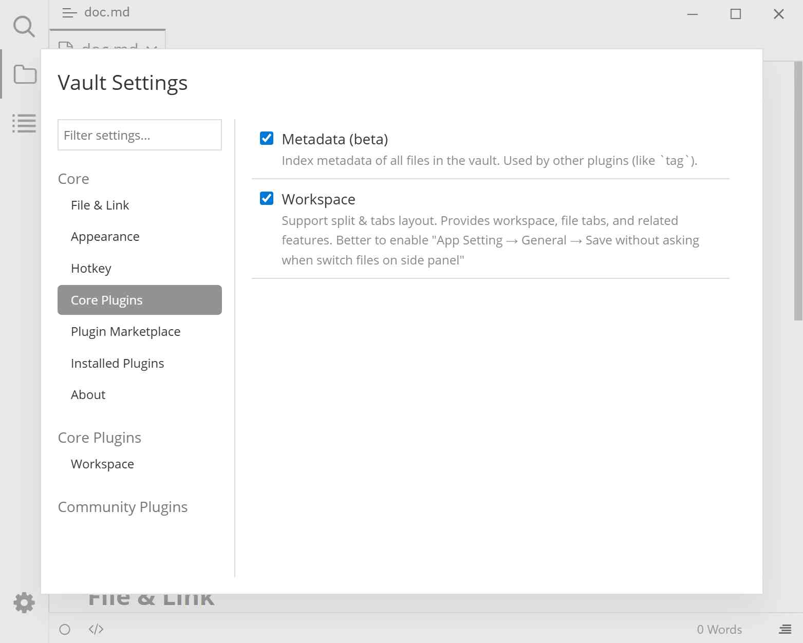

# Core Plugins

Core plugins are installed together with the plugin system and do not need to be downloaded from the marketplace. This page contains only on/off switches: check to enable, clear to disable.

## Preview

## Where to find it

Plugin Settings modal (<kbd>Ctrl</kbd>+<kbd>.</kbd>) → Core Plugins.

## Settings

| Setting | Default | Effect | Notes |
|--------|--------|------|------|
| Metadata (beta) | Off | Builds a metadata index for all files in the vault, used by structured searches such as tags, titles, and filenames, and by other plugins | The first enable performs a full index; the status bar shows `Indexing: completed/total` during it. Turning it off clears the index cache |
| Workspace | On | Provides file tabs, split view, the Markdown preview pane, the right sidebar, and the status bar toggle | When off, tabs and split view disappear, and the "Workspace" settings page is removed from the sidebar |

## Using Metadata (beta)

1. Check "Metadata (beta)" in "Core Plugins".
2. A progress indicator such as `Indexing: 0/120` appears on the right side of the status bar (the numbers are completed count and total). You can keep editing while indexing.
3. When the progress indicator disappears, indexing is complete. Only then can structured queries in [Advanced search](./4c-advanced-search.md) return results.
4. The index is cached and reused on the next launch; it updates incrementally when files are saved, renamed, or deleted.

> The indexing status bar text is the English string `Indexing:`. This is the plugin's original wording, not a language setting that failed to apply.

## Using Workspace

Workspace is enabled by default. When disabled:

- The editor returns to Typora's native single-document mode, and file tabs, split view, and the preview pane all disappear.
- The "Toggle right sidebar" button in the status bar disappears, and the [Right Sidebar](./4d-right-panel.md) is unavailable.
- The "Workspace" page is also removed from the settings sidebar. Checking it again restores it, but the previous tab state is not preserved.

## Notes and limitations

- The metadata index only covers Markdown and image files; other files are not matched by structured queries even if they appear in the file tree.
- Disk and CPU usage increase during indexing. For large vaults, enable it when idle and leave it on after it completes.
- Disabling Workspace does not affect installed community plugins, but plugin features that depend on tabs or the right sidebar stop working.

## Related pages

- [Advanced search](./4c-advanced-search.md)
- [Workspace](./4a-workspace.md)
- [Right Sidebar](./4d-right-panel.md)
- [Appearance](./3b-appearance.md)
