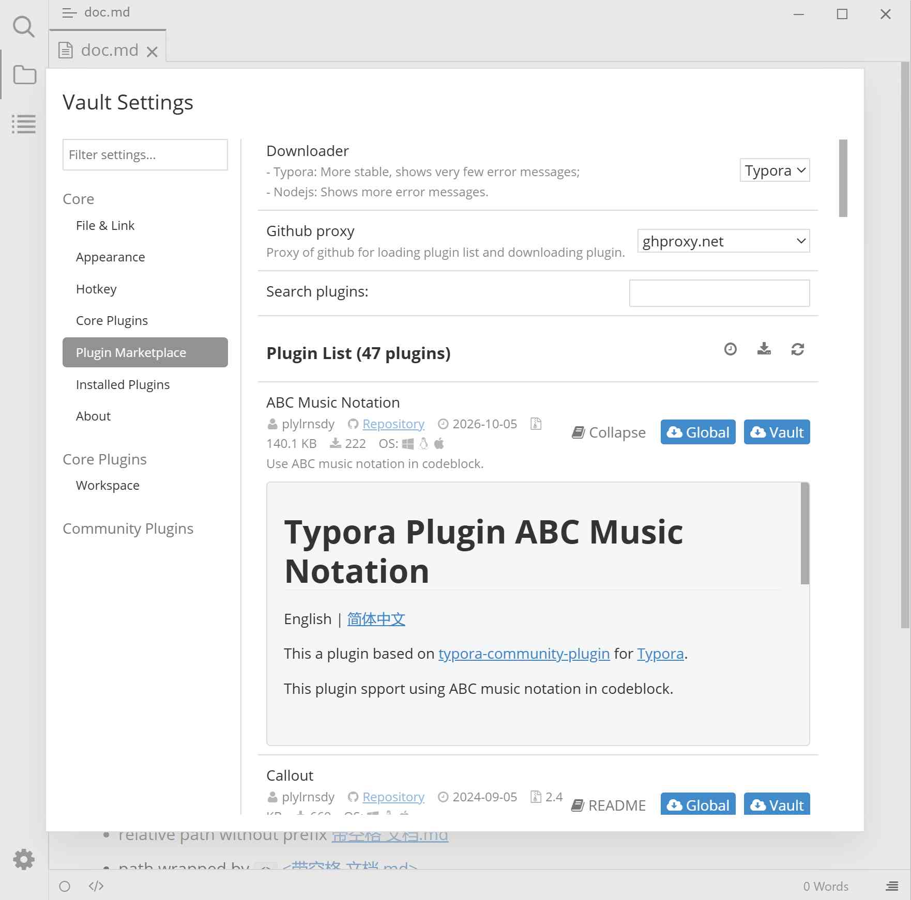

# Plugin Marketplace

Browse, search, and install community plugins. The list data comes from the plugin release repository maintained by the project and requires a network connection.

## Preview

## Where to find it

Plugin Settings modal (<kbd>Ctrl</kbd>+<kbd>.</kbd>) → Plugin Marketplace. The list reloads automatically every time you switch to this page.

## Settings

| Setting | Default | Effect | Notes |
|--------|--------|------|------|
| Downloader | `Typora` (`CLI` on macOS) | Choose how plugin packages are downloaded: `Typora` is more stable and shows fewer error messages; `Nodejs` shows more detailed error information | Only shown on Windows / Linux |
| Github proxy | `github` (direct) | Proxy used when loading the plugin list and downloading plugins | Options include `gh-proxy.com`, `gh-proxy.org`, `ghproxy.net`, and `ghproxy.homeboyc.cn`; switch to another one if a direct connection fails |
| Search plugins: | Empty | Filter cards by plugin name and description, case-insensitive | Takes effect after about 0.5 seconds |
| Plugin List ({0} plugins) | — | Three buttons on the right of the title: clock = sort by last update (newest first), download icon = sort by downloads (most first), refresh = reload the plugin list | Click a sort button again to cancel sorting and return to the default order |

## Plugin cards

| Element | Description |
|------|------|
| Name, author, description | Basic plugin information |
| `Repository` | Click to open the plugin's source repository |
| Last Update, Size, Downloads | Only shown when statistics are available |
| `OS:` platform icons | Indicate the platforms the plugin supports |
| "README" | Download and expand the repository's `README.md`; shows "Loading…" while loading, and the button changes to "Collapse" when expanded |
| "Global" | Install to the global plugin directory, available to all vaults |
| "Vault" | Install to `.typora/plugins` in the current vault; only shown when vault settings are active |

On success it shows `The plugin "{name}" has been installed successfully.`, and the install button disappears from that card. **Installing does not enable the plugin**; check it in [Installed Plugins](./3f-installed-plugins.md).

## Common usage

**The list is always empty**

1. Make sure Github is reachable.
2. Change "Github proxy" to `gh-proxy.com` or `ghproxy.net`.
3. Click "Reload Plugin List".

**Use a plugin in only one vault**

1. First make that vault use [vault settings](./3-settings.md) (run "Use vault settings" in the Command Panel).
2. Return to Plugin Marketplace; a "Vault" button appears on the cards.

## Notes and limitations

- The list and statistics come from the network. When offline, it shows "Plugin List (0 plugins)" without an error reason.
- If a proxy setting becomes invalid, it shows "Github proxy is removed and has been automatically reverted to the default settings." and switches back to `github` automatically.
- A failed download shows "Download failed. You can retry later."; the `Nodejs` downloader provides English error details.
- README content is fetched separately from the network; cached content is cleared when you switch proxies.
- The marketplace has no "install local zip" entry; for offline installation, use [manual installation](./2-plugin-installation.md).

## Related pages

- [Plugin installation](./2-plugin-installation.md)
- [Installed Plugins](./3f-installed-plugins.md)
- [Settings overview](./3-settings.md)
