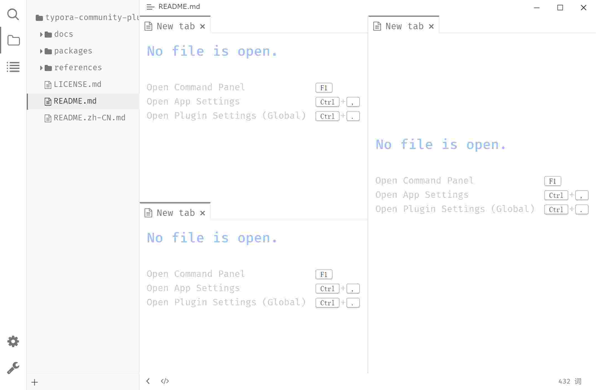

# Workspace

Workspace turns Typora's single-document editor into a **multi-tab + split view + preview pane** layout, similar to browser tabs.

## Preview

## Where to find it

Workspace is a core plugin and is enabled by default. After you open a file, file tabs appear above the editor.

- Enable/disable: Plugin Settings modal → [Core Plugins](./3d-internal-plugins.md) → "Workspace".
- Turn off tabs, hide extensions, etc.: Plugin Settings modal → Core Plugins settings → [Workspace settings](#workspace-settings).

## Usage

### File tabs

| Action | How |
|------|------|
| Switch files | Left-click a tab |
| Close a tab | Click the <kbd>×</kbd> on the right side of the tab, or **middle-click** the tab |
| Close multiple tabs | Right-click a tab → "Close" / "Close other tabs" / "Close tabs to right" |
| Reorder tabs | Drag a tab to reorder it within the same pane, or drag it to another pane |
| Browse overflowing tabs | Scroll the mouse wheel over the tab bar to scroll it horizontally |
| See the full path | Hover over a tab; the tooltip shows the path relative to the vault |

Long tab names are truncated with `…`. Unsaved new file tabs show `Untitled` (English).

### Split view

| Action | How |
|------|------|
| Split left/right | Run "Workspace: Split right" in the Command Panel |
| Split top/bottom | Run "Workspace: Split down" in the Command Panel |
| Open a file on the right | Right-click a file in the file tree → "Open to the right", or right-click a tab → "Split right" |
| Open a file below | Right-click a tab → "Split down" |
| Exit split view | Run "Workspace: Reset" in the Command Panel |
| Resize panes | Drag the divider between panes |

> "Split right" and "Split down" in the tab context menu only appear when the current pane has two or more tabs.

### Markdown preview pane

After splitting, you can use one side as a read-only preview:

- The preview pane shows rendered Markdown; its title bar icon differs from an editor tab (a filled document icon).
- Clicking the preview area **swaps** it with the current editor: the preview becomes editable, and the original editor becomes the preview.
- This behavior is controlled by "Swap editor and preview on click" and is enabled by default; when off, clicking the preview no longer swaps.

### Empty tab page

When you create a new tab with no file open, the page shows "No file is open." and lists the currently available shortcuts (open Command Panel, open app settings, open Plugin Settings modal).

- This hint page is shown by default; check "Use blank New Tab" to show a completely blank page instead.
- The new tab title is `New tab` (English).

## Workspace settings

Plugin Settings modal → Core Plugins settings → Workspace.

| Setting | Default | Effect | Notes |
|--------|--------|------|------|
| Use File Tabs | On | Open files as tabs in the main editor area | When off, there is no tab bar and tabs cannot be switched or closed |
| Hide extension in file tab | Off | A tab for `File.md` is shown as `File` | Only affects tab labels, not file names |
| Use blank New Tab | Off | Show a blank page for new tabs instead of the "No file is open." hint | — |
| Swap editor and preview on click | On | Clicking the preview pane makes it the editor and turns the original editor into the preview | When off, the preview is strictly read-only |
| Enable Audio View | On | Open audio files with the built-in viewer | See [File viewers](./4e-file-views.md) |
| Enable Video View | On | Open video files with the built-in viewer | Same as above |
| Enable Image View | On | Open image files with the built-in viewer | Same as above |

## Notes and limitations

- We strongly recommend enabling "Automatically save changes to the previous file when switching files" in Typora's "App Settings → General"; otherwise unsaved changes must be saved manually when switching tabs.
- When Workspace is disabled, tabs, split view, the preview pane, and the [Right Sidebar](./4d-right-panel.md) disappear together, and Typora returns to its native editor.
- Unsaved file tabs are named `Untitled` and new tabs are named `New tab`; these do not change with the UI language.

## Related pages

- [Core Plugins](./3d-internal-plugins.md)
- [Right Sidebar](./4d-right-panel.md)
- [File viewers](./4e-file-views.md)
- [Ribbon](./4b-ribbon.md)
