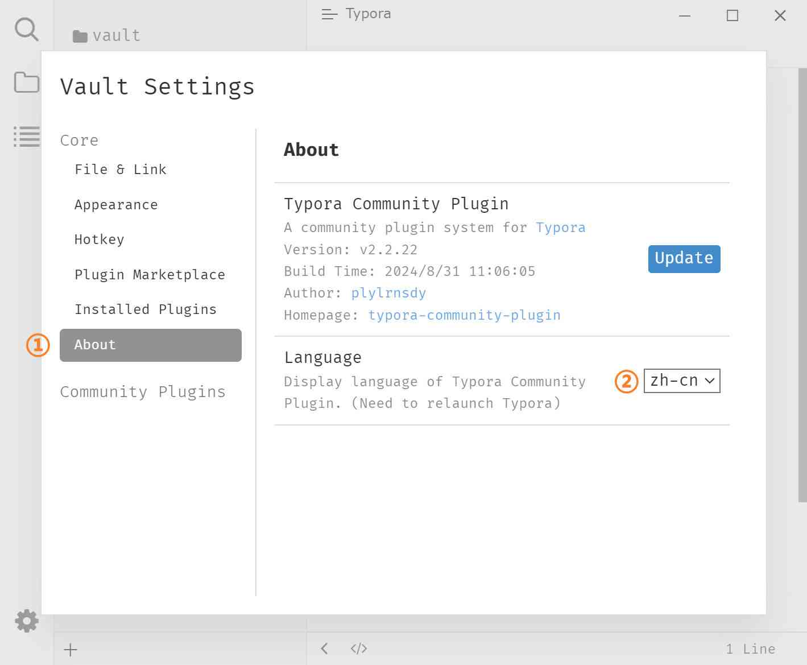

# Switching languages

The plugin system provides Chinese, English, and German UIs. You can switch at runtime; the change fully takes effect after a restart.

## Preview

## Where to switch

Plugin Settings modal (<kbd>Ctrl</kbd>+<kbd>.</kbd>) → [About](./3g-about.md) → "Language" dropdown.

> Note that this is not Typora's native "Preferences", but this plugin's own settings modal.

## Steps

1. Press <kbd>Ctrl</kbd>+<kbd>.</kbd> to open the Plugin Settings modal.
2. Switch to the "About" page and find "Language".
3. Select the target language in the dropdown.
4. Close the modal and **restart Typora**.

After restarting, plugin UI text such as the settings modal, Ribbon tooltips, and the search result header uses the new language.

## Supported languages

| Code | Language | Dropdown label |
|------|------|------------|
| `en` | English | English |
| `zh-cn` | Simplified Chinese | 简体中文 |
| `de` | German | Deutsch |

## Notes and limitations

- The language setting is saved in the currently active settings (global or vault); you need to select it again after switching settings mode.
- Only the plugin system's own UI changes; Typora's native menus and dialogs are unaffected.
- A few strings are fixed in English and do not change with the language: the unsaved file tab `Untitled`, the new tab `New tab`, the local plugin badge `Local Plugin`, and the indexing progress `Indexing: n/N`.
- If a translation is incomplete, missing entries fall back to English.
- To add or fix translations, see the developer documentation: [Locale files](https://github.com/typora-community-plugin/typora-community-plugin/blob/main/docs/en-us/dev-guide/3-locales.md).

## Related pages

- [About](./3g-about.md)
- [Settings overview](./3-settings.md)
