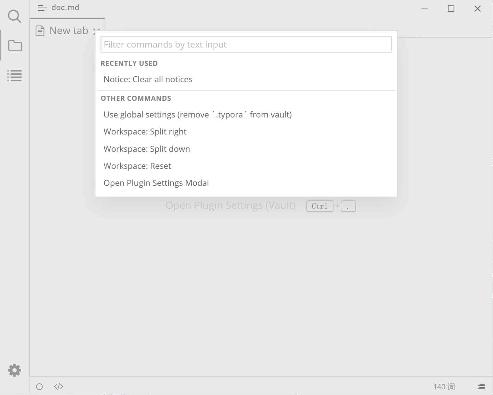

# Command Panel

Press <kbd>F1</kbd> to open the Command Panel; type keywords to search and run all commands provided by plugins without remembering shortcuts.

## Preview

## How to open it

- Press <kbd>F1</kbd>.
- Plugins can also invoke "Open Command Panel" from their own UI, with the same result.

## Operations

| Operation | How |
|------|------|
| Filter commands | Type directly in the input box; the placeholder reads "Filter commands by text input" |
| Move selection | <kbd>↑</kbd> / <kbd>↓</kbd> |
| Run a command | <kbd>Enter</kbd>, or click with the mouse |
| Close the panel | <kbd>Esc</kbd>, or click outside the panel |

## List structure

- **Recently Used**: up to 5 recently executed commands, newest first.
- **Other Commands**: all other available commands.

Command names include the plugin name as a prefix, e.g. `Tag: Open Tag Panel`, to distinguish commands with the same name from different plugins.

## Common usage

**Run a command without remembering a shortcut**

Press <kbd>F1</kbd>, type `vault settings`, select "Use vault settings (add `.typora` to vault)", and press Enter to switch the current vault to vault settings. See [Settings overview](./3-settings.md) for details.

**Find all commands from a plugin**

Type the plugin name (e.g. `Tag`); the list then shows only commands provided by that plugin.

## Notes and limitations

- A few internal commands do not appear in the list (for example "Open Command Panel" itself, and commands that plugins do not mark as visible).
- Commands from disabled plugins do not appear in the list.
- The command list updates immediately when plugins are enabled or disabled; no restart is needed.
- "Recently Used" is stored in Typora's local storage and does not change with the settings mode.

## Related pages

- [Hotkey settings](./3c-hotkey.md)
- [Plugin installation](./2-plugin-installation.md)
- [Settings overview](./3-settings.md)
