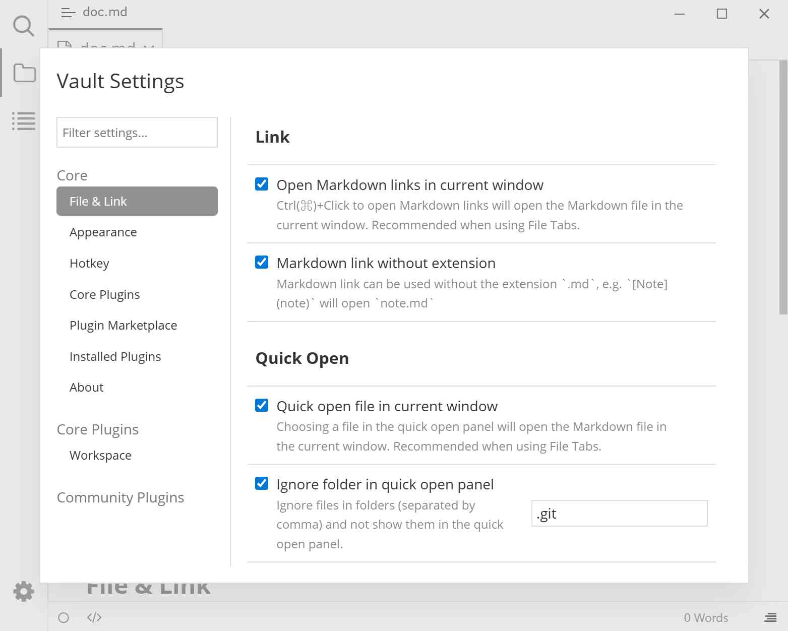

# 设置总览

插件配置对话框（<kbd>Ctrl</kbd>+<kbd>.</kbd>）集中管理插件系统的全部设置。设置分为**全局设置**和**本地设置**两套，同一时间只有一套生效。

## 预览

## 打开设置

- 按下 <kbd>Ctrl</kbd>+<kbd>.</kbd>（macOS 同样是 <kbd>Ctrl</kbd>）。
- 或按下 <kbd>F1</kbd> 打开[命令面板](./6-command-palette.md)，执行「打开插件配置对话框」。
- 或点击[活动栏](./4b-ribbon.md)底部的齿轮图标 →「打开插件设置 (全局)」/「打开插件设置 (本地)」。

对话框标题会显示当前生效的是「全局设置」还是「本地设置」。

## 对话框布局

| 区域 | 说明 |
|------|------|
| 顶部搜索框 | 占位文案「过滤设置...」，按**设置页名称**过滤左侧列表，不搜具体设置项 |
| 核心设置 | 7 个内置设置页，见下表 |
| 内置插件设置 | 由内置插件提供的设置页，目前只有「工作区」（需先启用工作区） |
| 社区插件设置 | 由已启用社区插件提供的设置页，按名称字母排序 |

| 核心设置页 | 管什么 |
|------------|--------|
| [文件与链接](./3a-file-and-link.md) | 链接的打开方式、快速打开面板 |
| [外观](./3b-appearance.md) | 不支持的文件、搜索面板、活动栏显隐 |
| [快捷键](./3c-hotkey.md) | 为命令绑定快捷键 |
| [内置插件](./3d-internal-plugins.md) | 启用或停用内置插件 |
| [插件市场](./3e-plugin-marketplace.md) | 浏览与安装社区插件 |
| [已安装插件](./3f-installed-plugins.md) | 启用、更新、卸载社区插件 |
| [关于](./3g-about.md) | 版本、更新、语言 |

打开对话框时默认停在「文件与链接」。按 <kbd>Esc</kbd> 或点击对话框外部可关闭。

## 使用本地设置

默认所有笔记库共用全局设置。只想让当前笔记库使用单独配置时：

**方式一：手动创建**

在当前笔记库目录下创建一个名为 `.typora` 的目录，并在其中编写设置。再次打开对话框时标题会变成「本地设置」。

**方式二：命令面板**

1. 按下 <kbd>F1</kbd> 打开命令面板。
2. 输入 `使用本地设置`，执行「使用本地设置 (添加 `.typora` 到本地)」。
3. 插件系统会把全局设置**复制**一份到笔记库的 `.typora` 目录，并立即切换为本地设置。

## 重新使用全局设置

**方式一：手动删除**

删除当前笔记库目录下的 `.typora` 目录。

**方式二：命令面板**

1. 按下 <kbd>F1</kbd> 打开命令面板。
2. 输入 `使用全局设置`，执行「使用全局设置 (从本地删除 `.typora`)」。
3. 本地设置目录会被删除，随后使用全局设置。

## 注意与限制

- 两种模式下的设置、快捷键、已启用插件、已安装的本地插件是**两套独立数据**，切换后界面可能明显不同。
- 「使用本地设置」是复制而非迁移：之后修改全局设置，不会影响已切换到本地的笔记库。
- 「使用全局设置」会**直接删除**笔记库的 `.typora` 目录，其中的本地插件与配置不会保留。
- 切换笔记库（打开另一个文件夹）时会按该笔记库是否含 `.typora` 重新决定使用哪套设置，界面会重新加载。

## 相关页面

- [快捷键设置](./3c-hotkey.md)
- [内置插件](./3d-internal-plugins.md)
- [插件安装](./2-plugin-installation.md)
