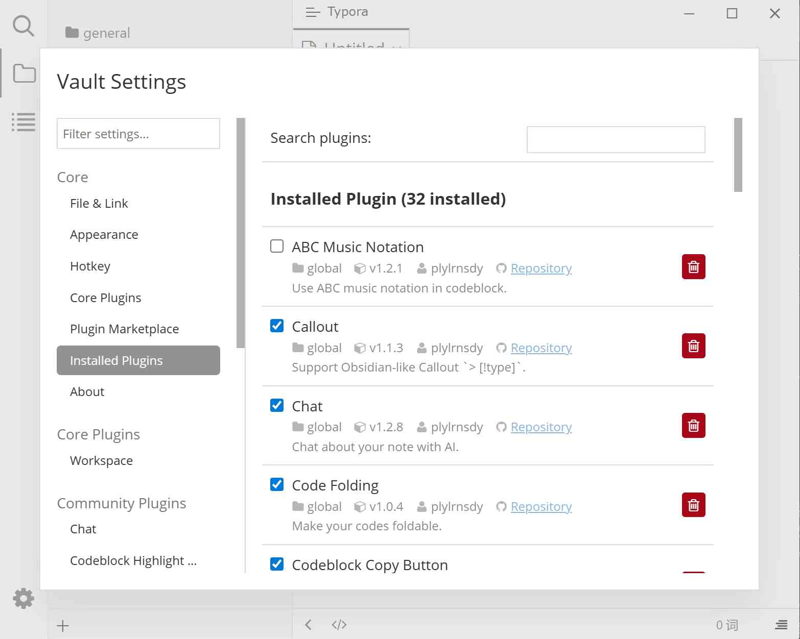

# 已安装插件

管理已经下载到本机的社区插件：启用、停用、更新、卸载。全局插件与当前笔记库的插件会一起列在这里。

## 预览

## 在哪里打开

插件配置对话框（<kbd>Ctrl</kbd>+<kbd>.</kbd>）→ 已安装插件。侧栏该页旁的徽章数字表示**可更新插件数量**。

## 页面元素

| 元素 | 说明 |
|------|------|
| 搜索插件: | 按名称与描述过滤已安装插件 |
| 已安装插件 (共 {0} 个) | 当前安装总数 |
| 复选框 | 勾选启用、取消勾选停用，立即生效 |
| `Local Plugin` 徽章 | 表示该插件不在市场列表中（本地手动安装或已下架）；徽章文字为英文 |
| 位置 / 版本 / 作者 | 标明安装在全局还是笔记库、当前版本号与作者 |
| `Repository` | 跳转到插件源码仓库 |
| 「更新」 | **仅在有新版本时出现**，点击后先卸载再重装，位置与启用状态保持不变 |
| 「卸载」 | 删除该插件目录（移入系统回收站） |

## 操作步骤

### 检查与安装更新

打开该页即可，插件系统会自动拉取市场列表并比对版本，无需点击「检查更新」：

- 有新版本：页面顶部徽章显示数量，对应插件右侧出现「更新」按钮。
- 无新版本：不出现「更新」按钮。

点击「更新」后提示「插件 "{插件名}" 更新成功。」；若已是最新则提示「插件 "{插件名}" 已是最新版本。」。

### 停用而不卸载

取消插件卡片上的复选框。停用后插件提供的命令、面板、设置页立即消失，插件文件仍保留在磁盘上，随时可以重新勾选。

### 卸载

点击「卸载」按钮即可。

> **没有二次确认**：点击后立即执行，插件目录被移入回收站。插件自己的数据文件不会被删除。

## 注意与限制

- 更新检测依赖网络。离线时不会出现「更新」按钮，已安装插件仍可正常启用。
- 插件要求更高的插件系统版本时，勾选会被拒绝并提示「插件 "{插件名}" 需要更高版本的 Typora Community Plugin。请检查更新。」。
- 卸载正在使用的插件后，其占用的面板会被移除；若该插件有未保存的界面状态，这些状态会丢失。
- 手动放到插件目录、但缺少有效 `manifest.json` 的文件夹不会出现在列表中。

## 相关页面

- [插件安装](./2-plugin-installation.md)
- [插件市场](./3e-plugin-marketplace.md)
- [升级插件](./1c-update.md)
