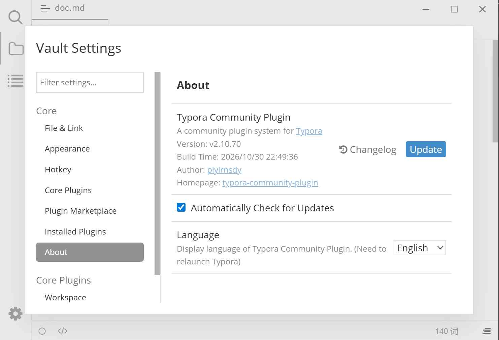

# 关于

查看插件系统版本、检查更新、打开更新日志、切换界面语言。

## 预览

## 在哪里打开

插件配置对话框（<kbd>Ctrl</kbd>+<kbd>.</kbd>）→ 关于。

## 页面元素

| 元素 | 说明 |
|------|------|
| 版本 | 当前安装的插件系统版本号，例如 `版本: v2.10.70` |
| 构建时间 | 该版本的打包时间 |
| 作者 | 项目作者 |
| 项目主页 | 点击跳转到项目仓库 |
| 「更新」 | 检查并安装新版本；已是新版时提示「Typora Community Plugin 已是最新版本。」 |
| 「更新日志」 | 下载并展开 `CHANGELOG.md`，首次加载显示「加载中…」，展开后变为「收起」 |
| 自动检查更新 | 默认开启，每次启动后首次打开本对话框时检查一次 |
| 语言 | 切换插件系统界面语言，选项来自已提供的翻译 |

标题右侧在检测到新版本时显示「有更新」徽章，鼠标悬停可看到最新版本号；侧栏「关于」旁会显示 `New`。

## 操作步骤

### 升级到新版本

1. 打开本页，点击「更新」。
2. 等待下载与替换完成，界面提示「Typora Community Plugin 更新成功。(需要重启 Typora)」。
3. 重启 Typora。

详见[升级插件](./1c-update.md)。

### 切换界面语言

1. 在「语言」下拉框中选择目标语言（如「简体中文」）。
2. 重启 Typora 使界面文案完全更新。

详见[切换语言](./5-i18n.md)。

### 关闭自动检查更新

取消勾选「自动检查更新」。之后不再自动请求版本信息，「有更新」与 `New` 徽章一并消失，但仍可手动点击「更新」。

## 注意与限制

- 「更新」走 Github 下载；网络受限时可能失败，可先在[插件市场](./3e-plugin-marketplace.md)更换 Github 代理。
- 更新日志需要联网获取；仓库未提供时提示「未在本仓库找到更新日志。」。
- 「语言」只影响插件系统自身界面（设置对话框、活动栏提示、搜索结果头部等），不会改变 Typora 原生菜单语言。

## 相关页面

- [升级插件](./1c-update.md)
- [切换语言](./5-i18n.md)
- [插件市场](./3e-plugin-marketplace.md)
