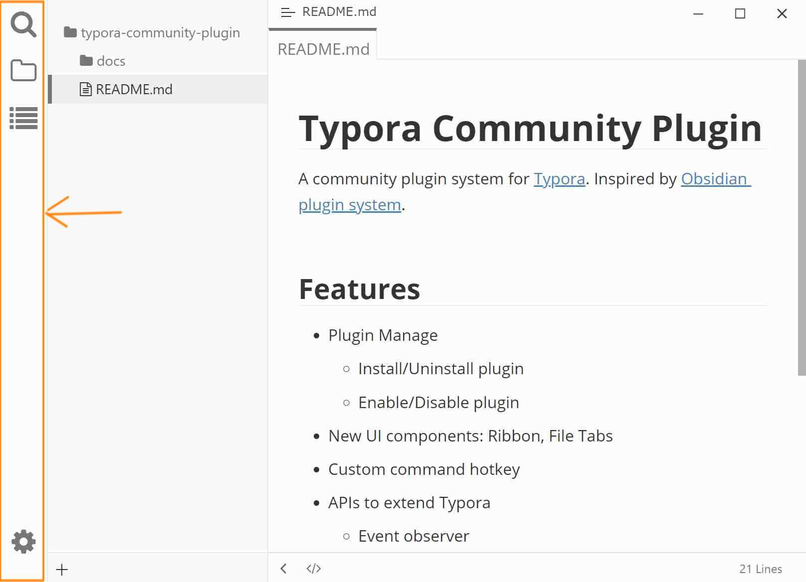

# 活动栏（Ribbon）

左侧竖排图标条，用来在文件、搜索、大纲等侧栏面板之间切换，也是插件的入口区。

## 预览

## 在哪里打开

安装后默认显示。隐藏或恢复：插件配置对话框 → [外观](./3b-appearance.md) → 高级选项 →「显示活动栏」。

## 按钮

| 图标 | 提示文字 | 作用 |
|------|----------|------|
| 放大镜 | 搜索文件内容 | 显示/切换到搜索面板 |
| 文件夹 | 文件管理 | 显示/切换到文件树 |
| 列表 | 大纲 | 显示/切换到 Typora 大纲 |
| 齿轮（位于底部） | 设置 | 打开快捷菜单，见下 |

插件也可以注册自己的活动栏按钮（例如标签插件），这些按钮与内置按钮并列显示。

### 切换面板

- **左键单击**图标：显示对应侧栏；再次单击当前激活的图标会**收起**侧栏。
- 当前激活的图标高亮显示。

### 管理图标

- **右键单击**图标区域：弹出菜单，逐项勾选/取消勾选以控制每个图标的显示与隐藏。
- **拖动**图标上下移动：调整顺序，松手后自动保存，下次启动保持。
- 被隐藏的图标不会占用活动栏位置。

### 底部齿轮菜单

点击底部齿轮图标，弹出两项：

| 菜单项 | 作用 |
|--------|------|
| 打开应用设置 | 打开 Typora 原生偏好设置 |
| 打开插件设置 (全局) / 打开插件设置 (本地) | 打开插件配置对话框，括号内为当前生效的设置模式 |

第二项的文字会随当前设置模式变化；效果等同于 <kbd>Ctrl</kbd>+<kbd>.</kbd>。

## 注意与限制

- 活动栏隐藏后，侧栏面板仍可通过 Typora 原生入口或[命令面板](./6-command-palette.md)打开。
- 图标的显隐与顺序保存在当前生效的设置中，切换到「本地设置」后是一套独立配置。
- 活动栏依赖自定义侧边面板机制，关闭「显示活动栏」会同时停用该机制，插件注册的侧栏入口不再显示。

## 相关页面

- [外观](./3b-appearance.md)
- [工作区](./4a-workspace.md)
- [右侧面板](./4d-right-panel.md)
