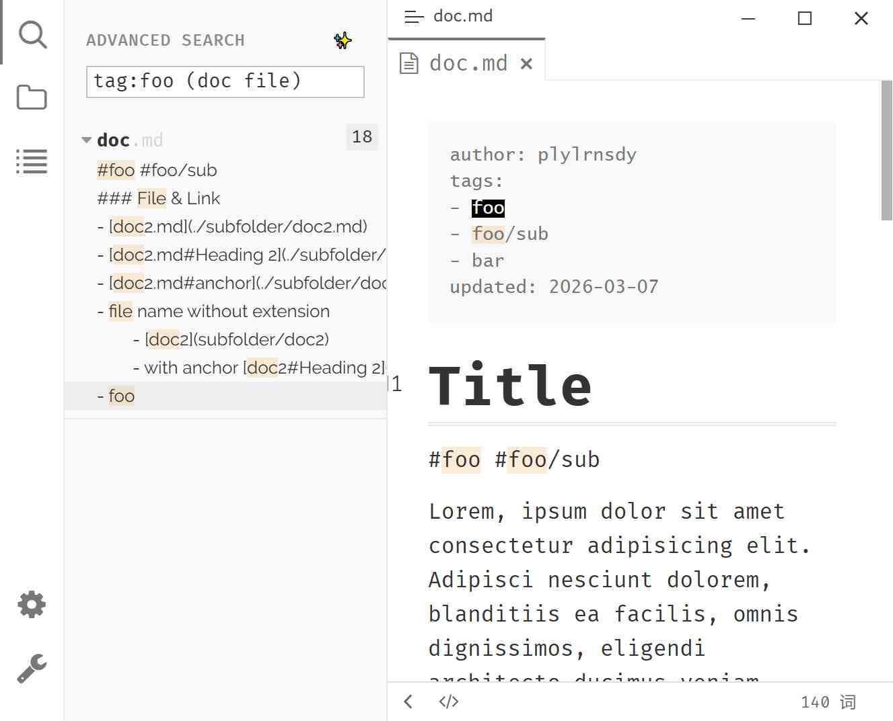

# 高级搜索

高级搜索用一套查询语法替代 Typora 原生搜索，支持字段前缀（`tag:`、`title:`、`filename:`）、布尔组合和精确短语，在整个笔记库中定位内容。

## 预览



## 前置条件：启用元数据索引

高级搜索依赖[元数据（测试版）](./3d-internal-plugins.md)内置插件，而它**默认关闭**。未开启时，高级模式下**所有查询都会返回空结果**，且没有任何错误提示。

1. 插件配置对话框 → 内置插件 → 勾选「元数据 (测试版)」。
2. 等待状态栏的 `Indexing: 已完成/总数` 进度消失。
3. 回到搜索面板，此时再输入查询。

## 启用高级搜索模式

1. 点击[活动栏](./4b-ribbon.md)中的**搜索**图标，打开搜索面板。
2. 搜索框**上方**有一行：左侧文字为「搜索」（开启后变为「高级搜索」），右侧是 <button class="ty-plugin-advanced-search-btn" style="display:inline-block; padding: 2px 8px; border: 1px solid #999; border-radius: 3px; cursor: pointer;">✨</button> 按钮。
3. 左键单击 ✨ 按钮即可启用/禁用。启用后该行文字变为「高级搜索」，按钮高亮。
4. 鼠标悬停在「高级搜索」文字上，会显示语法速查提示。

> 这一行的位置在搜索框上方，不在搜索框右侧；无论是否启用都会显示。
>
> 与 插件配置 → [外观](./3b-appearance.md) → 搜索 →「高级搜索模式」是同一个开关。

启用后搜索行为由自定义引擎接管，支持下面的语法；关闭后回到 Typora 原生文本匹配。

## 查询语法

### 基本词

直接输入单词或短语，扫描笔记库中的所有文件：

```
hello world
```

多个词之间是隐式 **AND**，结果必须同时包含所有关键词（见文末「已知限制」）。

需要连续短语时用双引号包裹：

```
"exact phrase"
```

引号内按**单个行内的连续子串**匹配，不跨行。

### 字段前缀

| 前缀 | 匹配对象 | 示例 |
|------|----------|------|
| `tag:` | frontmatter 的 `tags` 与正文内联 `#标签` | `tag:project` |
| `title:` | frontmatter 的 `title` 与正文中所有 `#` 标题（H1–H6） | `title:Meeting` |
| `filename:` | 文件名（含扩展名） | `filename:report` |

- 前缀本身不区分大小写，`Tag:`、`TAG:` 都可用。
- 冒号后**不能有空格**：`tag: foo` 会被当作普通文本。
- 值不能包含空格或引号，`title:"my heading"` 不成立。

**标签搜索**

| 查询 | 范围 |
|------|------|
| `tag:foo` | frontmatter 标签与正文内联 `#foo` |
| `#foo` | 按普通文本匹配，只出现在正文中 |
| `tag:foo -#foo` | 排除正文中与 `#foo` 出现在同一行的结果（见文末「已知限制」） |

标签是**精确匹配**：`tag:foo` 不匹配 `foobar`、`my-foo`；`tag:project` 也不匹配 `project/sub-task`。层级标签需要写全路径：

```
tag:project/sub-task
```

> 写成 `tag:#foo` 无法匹配正文内联标签，请省略 `#`。

### 布尔运算符

**AND（隐式）**

```
meeting notes
```

**OR（显式）**

`OR` 必须**大写**，小写 `or` 会被当作普通单词：

```
book OR film
```

括号用于分组和调整优先级：

```
(book OR film) tag:movies
```

**NOT（否定）**

在词或括号前加减号：

```
tag:project -deprecated
(tag:work OR tag:personal) -(meeting OR call)
```

### 组合示例

```
(book film) OR tag:game
```

查找同时含 `book` 与 `film`，或带有 `game` 标签的文件。

## 结果列表

- 结果**按文件分组**，每个文件下列出命中的行，命中片段高亮。
- 文件条目上的数字是命中的行数，不保证与实际匹配次数一致。
- 面板顶部有细进度条表示搜索进行中，没有文字与百分比。
- 界面不显示结果总数，也没有排序选项。

## 注意与限制

以下为当前实现的实际表现，与上面的语法描述有出入时以此为准：

1. **否定只作用于同一文件中已被匹配到的行。** 排除条件不会单独扫描整篇文档，跨行或超出扫描范围的内容不受 `-词` 影响。
2. **只写否定词（如 `-foo`）不会得到「不含 foo 的文件」。** 在元数据开启时可能返回整个笔记库，请始终配合至少一个正向关键词。
3. **`tag:foo -#tag` 不能限定为「只搜 frontmatter」。** 它只会抑制同一行同时出现的正文标签。
4. **`tag:#foo` 无效**，`#` 不会被去掉，必须写 `tag:foo`。
5. **`title:` 区分大小写**，`title:meeting` 找不到 `Meeting`；`filename:` 不区分大小写。
6. **frontmatter 标签匹配区分大小写，正文内联标签不区分。**
7. **不支持正则表达式。** `/foo/` 会被当作普通字符搜索。
8. **正文搜索上限：单文件 2 MiB，每文件最多返回 10 行匹配。** 大文件或命中过多的文件可能漏结果。
9. **正文搜索会跳过隐藏文件与被 `.gitignore` 忽略的文件**，但 `filename:`、`title:` 仍能命中它们。
10. **只索引 Markdown 与图片文件**，其他类型的文件不会被结构化查询命中。
11. **没有任何错误提示。** 语法写错、未开启元数据、引擎异常都只表现为「没有结果」。
12. **macOS 上正文结果的布尔与字段语义不生效**（正文检索走 Typora 原生引擎），只有元数据侧的 `tag:`/`title:`/`filename:` 仍由插件处理。需要完整语法时请在 Windows / Linux 上使用。

## 相关页面

- [内置插件](./3d-internal-plugins.md)
- [外观](./3b-appearance.md)
- [活动栏](./4b-ribbon.md)
