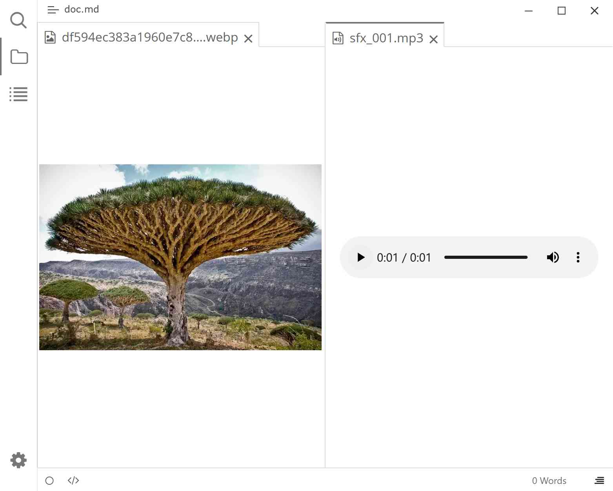

# 文件查看器

在文件标签页里直接查看图片、播放音频和视频，不需要跳出 Typora。

> 需 v2.10.33+。需要启用[工作区](./3d-internal-plugins.md)。

## 预览

## 支持的格式

| 查看器 | 扩展名 |
|--------|--------|
| 图片 | `.jpg` `.jpeg` `.png` `.gif` `.bmp` `.webp` `.svg` `.ico` `.avif` |
| 音频 | `.flac` `.m4a` `.mp3` `.ogg` `.wav` `.3gp` |
| 视频 | `.mkv` `.mov` `.mp4` `.ogv` `.webm` |

不在此列的文件（如 `.pdf`、`.zip`）仍交给系统默认程序打开。

## 使用

1. 在文件树或[快速打开面板](./3a-file-and-link.md)中打开一个上述格式的文件。
2. 文件会在新的标签页内用内置查看器打开：
   - 图片在标签页内按原尺寸显示，可滚动查看。
   - 音频、视频提供系统的播放、暂停、进度条与音量控件。
3. 标签页可以像 Markdown 文件一样关闭、拖动、分屏。

## 设置项

插件配置对话框 → 内置插件设置 → 工作区 → 主编辑区：文件视图。

| 设置项 | 默认值 | 作用 | 备注 |
|--------|--------|------|------|
| 启用音频查看 | 开启 | 用内置播放器打开音频文件 | 关闭后交给系统默认程序 |
| 启用视频查看 | 开启 | 用内置播放器打开视频文件 | 同上 |
| 启用图片查看 | 开启 | 用内置查看器打开图片文件 | 同上 |

## 注意与限制

- 文件树里是否**看得见**这些文件，取决于[外观](./3b-appearance.md) →「显示不支持的文件」。该选项关闭时，非文本文件可能不在文件树中列出。
- 关闭对应的查看器开关后，文件改用系统默认程序打开，不再出现标签页。
- 编码不受支持或文件损坏时，查看器区域会空白，不显示错误原因。
- 视频能否播放取决于系统解码器，个别封装格式可能只有声音或无法播放。

## 相关页面

- [工作区](./4a-workspace.md)
- [外观](./3b-appearance.md)
- [文件与链接](./3a-file-and-link.md)
